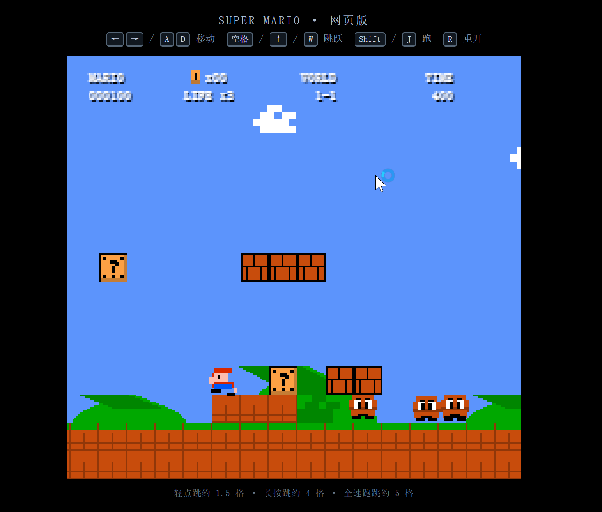

# 超级玛丽 · AI 协作开发实证项目

> 2026 第九届传智杯 · AI 创新应用挑战赛（个人赛）参赛作品

一名**编程零基础**的大一学生，在与 AI 的多轮意图引导下，完成了一款可在浏览器直接运行的像素平台跳跃游戏。
本项目的核心不是"做出一个游戏"，而是验证一套可复现的开发范式：

**人类定标准 → AI 写实现 → 测试说话。**

不需要安装任何环境，**下载后双击 `index.html` 即可开玩**。



---

## 快速开始

| 步骤 | 操作 |
|---|---|
| 1 | 点击本页右上角 `Code` → `Download ZIP`，解压 |
| 2 | 双击根目录的 `index.html` |
| 3 | 用键盘操作，开始游戏 |

**环境要求：无。** 纯静态页面，零依赖、零构建、零外部美术素材（全部像素由 Canvas 代码绘制）。

| 按键 | 功能 |
|---|---|
| ← → / A D | 左右移动 |
| 空格 / ↑ / W | 跳跃（长按跳得更高） |
| Shift / J | 加速跑 |
| R | 重新开始 |

## 项目结构

```
├── index.html              # 第二版游戏入口（双击即可运行）
├── style.css               # 布局与整数倍像素化渲染
├── game.js                 # 全部游戏逻辑（约 1300 行）
├── v1/mario.html           # 第一版基线（单屏、红色方块），单文件存档
├── PRD.md                  # 320 行产品需求文档，把“手感”量化为可验收数值
├── test-physics.js         # 物理参数自动化验收脚本（Node 运行）
├── 第一版制作报告.doc       # 开发过程记录（第一版）
├── 第二版制作报告.docx      # 开发过程记录（第二版）
└── screenshot-v1.png / screenshot-v2.png   # 两版运行截图
```

## 为什么这个项目值得看

### 1. 把"手感"变成了可验收的数字

模糊需求（"跳跃手感要像马里奥"）无法验收。所以人类侧先执笔 PRD，把需求翻译成带公差的硬指标，再让 AI 按约束实现：

| 指标 | PRD 要求 | 实测 | 结果 |
|---|---|---|---|
| 轻点跳高度 | 24px ± 4 | 24.6px | ✅ |
| 长按跳高度 | 64px ± 6 | 59.8px | ✅ |
| 跑跳高度 | 80px ± 8 | 77.1px | ✅ |
| 全速滑行距离 | 40~60px | 51.1px | ✅ |
| 0→最高速加速时间 | 0.4~0.6s | 0.40s | ✅ |

复跑验收（需安装 Node.js）：

```bash
node test-physics.js
```

脚本用模拟 DOM 在 Node 中逐帧运行真实物理逻辑，自动输出实测值并与 PRD 公差对比。

### 2. AI 交付后，人负责找 bug

AI 第一次交付的代码语法正确、能跑起来，但实测数据暴露了 3 个真实缺陷，均由人类通过数据定位、再引导 AI 修复：

| 缺陷 | 定位方式 | 根因 |
|---|---|---|
| 关卡加载即崩溃 | 运行时报错栈 | 解析字符地图时，在行数组入列前就索引它 |
| 轻点跳只有 10px | 逐帧打印 y/vy | 起跳当帧就执行了松键截断，把初速直接乘了倍率 |
| 参数无法同时达标 | 数学反解 | 截断倍率 0.4 与"轻点 24px"数学上不相容，需按 v=√(2gh) 反解 |

第三项是项目最有价值的一次判断：**AI 给的参数不一定自洽，人类要用数学去验算。** 最终按验收数值反推，取起跳初速 506 px/s、截断倍率 0.59。

### 3. 演进链路真实可查

| 阶段 | 产出 | 提交记录 |
|---|---|---|
| v1 基线 | 单屏红色方块，验证"AI 能写出可运行的代码" | `v1/: 第一版基线` |
| 需求工程 | 320 行 PRD，量化全部手感指标 | `docs: 补 PRD` |
| v2 实现 | 256×240 卷轴世界、200 格关卡、金币/敌人/HUD | 分批提交 |
| 验收修复 | 自动化验收脚本 + 参数反解 + bug 修复 | `tests: 增加物理验收脚本` |

## 技术要点

- 256×240 逻辑分辨率、16px 网格，NES 风格像素渲染（整数倍缩放，不糊不抖）
- 固定步长 1/60s 物理累加器，速度单位统一 px/s
- 200 格字符地图教学关：首怪 → 问号砖 → 砖排 → 递增管道 → 坑洞 → 怪群 → 旗杆
- 土狼时间 100ms + 跳跃缓冲 120ms + 可变跳跃高度（轻点/长按区分明显）
- 16 色全部收敛于统一调色板，无散落硬编码色值

## 说明

本项目为学习与研究用途的平台跳跃游戏**机制复刻**，不含任何任天堂原始美术、音频素材——所有像素图形均由 Canvas 代码逐块绘制。项目代码由 AI 生成、人类引导与验收，完整对话历史见参赛提交材料。

参赛选手：庄喻晴（个人赛）
